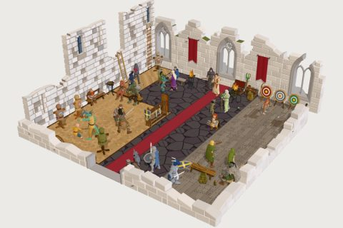

# Mythic Character Vault

In production, 63 parts so far. Every part below is already free to use.

[Open the kit on Polyfork](https://polyfork.dev/kit/the-ultimate-rpg-character-a066e1) · [All kits](../README.md#kits)

<table>
<tr>
<td align="center" valign="top" width="25%"> <a href="https://polyfork.dev/asset/adventurer-s-backpack-b1365c">Adventurer&#039;s Backpack</a> <a href="https://polyfork.dev/cdn/adventurer-s-backpack-b1365c.glb">GLB</a> · <a href="https://polyfork.dev/cdn/adventurer-s-backpack-b1365c.mjs">module</a></td>
<td align="center" valign="top" width="25%"> <a href="https://polyfork.dev/asset/archery-target-762034">Archery Target</a> <a href="https://polyfork.dev/cdn/archery-target-762034.glb">GLB</a> · <a href="https://polyfork.dev/cdn/archery-target-762034.mjs">module</a></td>
<td align="center" valign="top" width="25%"> <a href="https://polyfork.dev/asset/arming-sword-ab8738">Arming Sword</a> <a href="https://polyfork.dev/cdn/arming-sword-ab8738.glb">GLB</a> · <a href="https://polyfork.dev/cdn/arming-sword-ab8738.mjs">module</a></td>
<td align="center" valign="top" width="25%"> <a href="https://polyfork.dev/asset/arrow-eb66a4">Arrow</a> <a href="https://polyfork.dev/cdn/arrow-eb66a4.glb">GLB</a> · <a href="https://polyfork.dev/cdn/arrow-eb66a4.mjs">module</a></td>
</tr>
<tr>
<td align="center" valign="top" width="25%"> <a href="https://polyfork.dev/asset/climbable-stone-wall-0052e0">Climbable Stone Wall</a> <a href="https://polyfork.dev/cdn/climbable-stone-wall-0052e0.glb">GLB</a> · <a href="https://polyfork.dev/cdn/climbable-stone-wall-0052e0.mjs">module</a></td>
<td align="center" valign="top" width="25%"> <a href="https://polyfork.dev/asset/corked-potion-vial-a6e7e9">Corked Potion Vial</a> <a href="https://polyfork.dev/cdn/corked-potion-vial-a6e7e9.glb">GLB</a> · <a href="https://polyfork.dev/cdn/corked-potion-vial-a6e7e9.mjs">module</a></td>
<td align="center" valign="top" width="25%"> <a href="https://polyfork.dev/asset/crypt-flagstone-floor-b86b1a">Crypt Flagstone Floor</a> <a href="https://polyfork.dev/cdn/crypt-flagstone-floor-b86b1a.glb">GLB</a> · <a href="https://polyfork.dev/cdn/crypt-flagstone-floor-b86b1a.mjs">module</a></td>
<td align="center" valign="top" width="25%"> <a href="https://polyfork.dev/asset/double-bit-greataxe-d4f81b">Double-Bit Greataxe</a> <a href="https://polyfork.dev/cdn/double-bit-greataxe-d4f81b.glb">GLB</a> · <a href="https://polyfork.dev/cdn/double-bit-greataxe-d4f81b.mjs">module</a></td>
</tr>
<tr>
<td align="center" valign="top" width="25%"> <a href="https://polyfork.dev/asset/dragonborn-berserker-67ba6f">Dragonborn Berserker</a> <a href="https://polyfork.dev/cdn/dragonborn-berserker-67ba6f.glb">GLB</a> · <a href="https://polyfork.dev/cdn/dragonborn-berserker-67ba6f.mjs">module</a></td>
<td align="center" valign="top" width="25%"> <a href="https://polyfork.dev/asset/dragonborn-knight-9f16b1">Dragonborn Knight</a> <a href="https://polyfork.dev/cdn/dragonborn-knight-9f16b1.glb">GLB</a> · <a href="https://polyfork.dev/cdn/dragonborn-knight-9f16b1.mjs">module</a></td>
<td align="center" valign="top" width="25%"> <a href="https://polyfork.dev/asset/dragonborn-monk-6ee8c9">Dragonborn Monk</a> <a href="https://polyfork.dev/cdn/dragonborn-monk-6ee8c9.glb">GLB</a> · <a href="https://polyfork.dev/cdn/dragonborn-monk-6ee8c9.mjs">module</a></td>
<td align="center" valign="top" width="25%"> <a href="https://polyfork.dev/asset/dryad-hunter-093b74">Dryad Hunter</a> <a href="https://polyfork.dev/cdn/dryad-hunter-093b74.glb">GLB</a> · <a href="https://polyfork.dev/cdn/dryad-hunter-093b74.mjs">module</a></td>
</tr>
<tr>
<td align="center" valign="top" width="25%"> <a href="https://polyfork.dev/asset/dryad-priest-0c60e3">Dryad Priest</a> <a href="https://polyfork.dev/cdn/dryad-priest-0c60e3.glb">GLB</a> · <a href="https://polyfork.dev/cdn/dryad-priest-0c60e3.mjs">module</a></td>
<td align="center" valign="top" width="25%"> <a href="https://polyfork.dev/asset/dwarf-berserker-13558d">Dwarf Berserker</a> <a href="https://polyfork.dev/cdn/dwarf-berserker-13558d.glb">GLB</a> · <a href="https://polyfork.dev/cdn/dwarf-berserker-13558d.mjs">module</a></td>
<td align="center" valign="top" width="25%"> <a href="https://polyfork.dev/asset/dwarf-knight-2fff64">Dwarf Knight</a> <a href="https://polyfork.dev/cdn/dwarf-knight-2fff64.glb">GLB</a> · <a href="https://polyfork.dev/cdn/dwarf-knight-2fff64.mjs">module</a></td>
<td align="center" valign="top" width="25%"> <a href="https://polyfork.dev/asset/dwarf-priest-bcbea0">Dwarf Priest</a> <a href="https://polyfork.dev/cdn/dwarf-priest-bcbea0.glb">GLB</a> · <a href="https://polyfork.dev/cdn/dwarf-priest-bcbea0.mjs">module</a></td>
</tr>
<tr>
<td align="center" valign="top" width="25%"> <a href="https://polyfork.dev/asset/elf-assassin-944f87">Elf Assassin</a> <a href="https://polyfork.dev/cdn/elf-assassin-944f87.glb">GLB</a> · <a href="https://polyfork.dev/cdn/elf-assassin-944f87.mjs">module</a></td>
<td align="center" valign="top" width="25%"> <a href="https://polyfork.dev/asset/elf-hunter-511e25">Elf Hunter</a> <a href="https://polyfork.dev/cdn/elf-hunter-511e25.glb">GLB</a> · <a href="https://polyfork.dev/cdn/elf-hunter-511e25.mjs">module</a></td>
<td align="center" valign="top" width="25%"> <a href="https://polyfork.dev/asset/elf-mage-de335e">Elf Mage</a> <a href="https://polyfork.dev/cdn/elf-mage-de335e.glb">GLB</a> · <a href="https://polyfork.dev/cdn/elf-mage-de335e.mjs">module</a></td>
<td align="center" valign="top" width="25%"> <a href="https://polyfork.dev/asset/falchion-cf01a7">Falchion</a> <a href="https://polyfork.dev/cdn/falchion-cf01a7.glb">GLB</a> · <a href="https://polyfork.dev/cdn/falchion-cf01a7.mjs">module</a></td>
</tr>
<tr>
<td align="center" valign="top" width="25%"> <a href="https://polyfork.dev/asset/gnome-mage-2b94dc">Gnome Mage</a> <a href="https://polyfork.dev/cdn/gnome-mage-2b94dc.glb">GLB</a> · <a href="https://polyfork.dev/cdn/gnome-mage-2b94dc.mjs">module</a></td>
<td align="center" valign="top" width="25%"> <a href="https://polyfork.dev/asset/gnome-warrior-bbc2b5">Gnome Warrior</a> <a href="https://polyfork.dev/cdn/gnome-warrior-bbc2b5.glb">GLB</a> · <a href="https://polyfork.dev/cdn/gnome-warrior-bbc2b5.mjs">module</a></td>
<td align="center" valign="top" width="25%"> <a href="https://polyfork.dev/asset/goblin-assassin-f8d72b">Goblin Assassin</a> <a href="https://polyfork.dev/cdn/goblin-assassin-f8d72b.glb">GLB</a> · <a href="https://polyfork.dev/cdn/goblin-assassin-f8d72b.mjs">module</a></td>
<td align="center" valign="top" width="25%"> <a href="https://polyfork.dev/asset/goblin-berserker-2b28c2">Goblin Berserker</a> <a href="https://polyfork.dev/cdn/goblin-berserker-2b28c2.glb">GLB</a> · <a href="https://polyfork.dev/cdn/goblin-berserker-2b28c2.mjs">module</a></td>
</tr>
<tr>
<td align="center" valign="top" width="25%"> <a href="https://polyfork.dev/asset/goblin-mage-60c815">Goblin Mage</a> <a href="https://polyfork.dev/cdn/goblin-mage-60c815.glb">GLB</a> · <a href="https://polyfork.dev/cdn/goblin-mage-60c815.mjs">module</a></td>
<td align="center" valign="top" width="25%"> <a href="https://polyfork.dev/asset/grappling-hook-c05b86">Grappling Hook</a> <a href="https://polyfork.dev/cdn/grappling-hook-c05b86.glb">GLB</a> · <a href="https://polyfork.dev/cdn/grappling-hook-c05b86.mjs">module</a></td>
<td align="center" valign="top" width="25%"> <a href="https://polyfork.dev/asset/halfling-assassin-b99057">Halfling Assassin</a> <a href="https://polyfork.dev/cdn/halfling-assassin-b99057.glb">GLB</a> · <a href="https://polyfork.dev/cdn/halfling-assassin-b99057.mjs">module</a></td>
<td align="center" valign="top" width="25%"> <a href="https://polyfork.dev/asset/halfling-hunter-4fa876">Halfling Hunter</a> <a href="https://polyfork.dev/cdn/halfling-hunter-4fa876.glb">GLB</a> · <a href="https://polyfork.dev/cdn/halfling-hunter-4fa876.mjs">module</a></td>
</tr>
<tr>
<td align="center" valign="top" width="25%"> <a href="https://polyfork.dev/asset/halfling-monk-9bde42">Halfling Monk</a> <a href="https://polyfork.dev/cdn/halfling-monk-9bde42.glb">GLB</a> · <a href="https://polyfork.dev/cdn/halfling-monk-9bde42.mjs">module</a></td>
<td align="center" valign="top" width="25%"> <a href="https://polyfork.dev/asset/hand-crossbow-77a4c7">Hand Crossbow</a> <a href="https://polyfork.dev/cdn/hand-crossbow-77a4c7.glb">GLB</a> · <a href="https://polyfork.dev/cdn/hand-crossbow-77a4c7.mjs">module</a></td>
<td align="center" valign="top" width="25%"> <a href="https://polyfork.dev/asset/healing-herb-bundle-4d9724">Healing Herb Bundle</a> <a href="https://polyfork.dev/cdn/healing-herb-bundle-4d9724.glb">GLB</a> · <a href="https://polyfork.dev/cdn/healing-herb-bundle-4d9724.mjs">module</a></td>
<td align="center" valign="top" width="25%"> <a href="https://polyfork.dev/asset/hooded-staff-acolyte-f24f63">Hooded Staff Acolyte</a> <a href="https://polyfork.dev/cdn/hooded-staff-acolyte-f24f63.glb">GLB</a> · <a href="https://polyfork.dev/cdn/hooded-staff-acolyte-f24f63.mjs">module</a></td>
</tr>
<tr>
<td align="center" valign="top" width="25%"> <a href="https://polyfork.dev/asset/human-assassin-049e85">Human Assassin</a> <a href="https://polyfork.dev/cdn/human-assassin-049e85.glb">GLB</a> · <a href="https://polyfork.dev/cdn/human-assassin-049e85.mjs">module</a></td>
<td align="center" valign="top" width="25%"> <a href="https://polyfork.dev/asset/human-knight-f544dd">Human Knight</a> <a href="https://polyfork.dev/cdn/human-knight-f544dd.glb">GLB</a> · <a href="https://polyfork.dev/cdn/human-knight-f544dd.mjs">module</a></td>
<td align="center" valign="top" width="25%"> <a href="https://polyfork.dev/asset/human-mage-662684">Human Mage</a> <a href="https://polyfork.dev/cdn/human-mage-662684.glb">GLB</a> · <a href="https://polyfork.dev/cdn/human-mage-662684.mjs">module</a></td>
<td align="center" valign="top" width="25%"> <a href="https://polyfork.dev/asset/human-priest-02f0e6">Human Priest</a> <a href="https://polyfork.dev/cdn/human-priest-02f0e6.glb">GLB</a> · <a href="https://polyfork.dev/cdn/human-priest-02f0e6.mjs">module</a></td>
</tr>
<tr>
<td align="center" valign="top" width="25%"> <a href="https://polyfork.dev/asset/human-warrior-62c9a5">Human Warrior</a> <a href="https://polyfork.dev/cdn/human-warrior-62c9a5.glb">GLB</a> · <a href="https://polyfork.dev/cdn/human-warrior-62c9a5.mjs">module</a></td>
<td align="center" valign="top" width="25%"> <a href="https://polyfork.dev/asset/kite-shield-343e62">Kite Shield</a> <a href="https://polyfork.dev/cdn/kite-shield-343e62.glb">GLB</a> · <a href="https://polyfork.dev/cdn/kite-shield-343e62.mjs">module</a></td>
<td align="center" valign="top" width="25%"> <a href="https://polyfork.dev/asset/leather-belt-satchel-5bb107">Leather Belt Satchel</a> <a href="https://polyfork.dev/cdn/leather-belt-satchel-5bb107.glb">GLB</a> · <a href="https://polyfork.dev/cdn/leather-belt-satchel-5bb107.mjs">module</a></td>
<td align="center" valign="top" width="25%"> <a href="https://polyfork.dev/asset/living-wood-druid-staff-fd83c1">Living-Wood Druid Staff</a> <a href="https://polyfork.dev/cdn/living-wood-druid-staff-fd83c1.glb">GLB</a> · <a href="https://polyfork.dev/cdn/living-wood-druid-staff-fd83c1.mjs">module</a></td>
</tr>
<tr>
<td align="center" valign="top" width="25%"> <a href="https://polyfork.dev/asset/magic-wand-83682a">Magic Wand</a> <a href="https://polyfork.dev/cdn/magic-wand-83682a.glb">GLB</a> · <a href="https://polyfork.dev/cdn/magic-wand-83682a.mjs">module</a></td>
<td align="center" valign="top" width="25%"> <a href="https://polyfork.dev/asset/magnifying-lens-a8959c">Magnifying Lens</a> <a href="https://polyfork.dev/cdn/magnifying-lens-a8959c.glb">GLB</a> · <a href="https://polyfork.dev/cdn/magnifying-lens-a8959c.mjs">module</a></td>
<td align="center" valign="top" width="25%"> <a href="https://polyfork.dev/asset/monk-s-quarterstaff-cbdadd">Monk&#039;s Quarterstaff</a> <a href="https://polyfork.dev/cdn/monk-s-quarterstaff-cbdadd.glb">GLB</a> · <a href="https://polyfork.dev/cdn/monk-s-quarterstaff-cbdadd.mjs">module</a></td>
<td align="center" valign="top" width="25%"> <a href="https://polyfork.dev/asset/orc-hunter-4f0410">Orc Hunter</a> <a href="https://polyfork.dev/cdn/orc-hunter-4f0410.glb">GLB</a> · <a href="https://polyfork.dev/cdn/orc-hunter-4f0410.mjs">module</a></td>
</tr>
<tr>
<td align="center" valign="top" width="25%"> <a href="https://polyfork.dev/asset/orc-warrior-bffa73">Orc Warrior</a> <a href="https://polyfork.dev/cdn/orc-warrior-bffa73.glb">GLB</a> · <a href="https://polyfork.dev/cdn/orc-warrior-bffa73.mjs">module</a></td>
<td align="center" valign="top" width="25%"> <a href="https://polyfork.dev/asset/orcish-cleaver-7117ab">Orcish Cleaver</a> <a href="https://polyfork.dev/cdn/orcish-cleaver-7117ab.glb">GLB</a> · <a href="https://polyfork.dev/cdn/orcish-cleaver-7117ab.mjs">module</a></td>
<td align="center" valign="top" width="25%"> <a href="https://polyfork.dev/asset/pitch-torch-79d752">Pitch Torch</a> <a href="https://polyfork.dev/cdn/pitch-torch-79d752.glb">GLB</a> · <a href="https://polyfork.dev/cdn/pitch-torch-79d752.mjs">module</a></td>
<td align="center" valign="top" width="25%"> <a href="https://polyfork.dev/asset/prayer-bead-strand-e18d9a">Prayer Bead Strand</a> <a href="https://polyfork.dev/cdn/prayer-bead-strand-e18d9a.glb">GLB</a> · <a href="https://polyfork.dev/cdn/prayer-bead-strand-e18d9a.mjs">module</a></td>
</tr>
<tr>
<td align="center" valign="top" width="25%"> <a href="https://polyfork.dev/asset/rapier-d0c268">Rapier</a> <a href="https://polyfork.dev/cdn/rapier-d0c268.glb">GLB</a> · <a href="https://polyfork.dev/cdn/rapier-d0c268.mjs">module</a></td>
<td align="center" valign="top" width="25%"> <a href="https://polyfork.dev/asset/recurve-hunting-bow-2903c8">Recurve Hunting Bow</a> <a href="https://polyfork.dev/cdn/recurve-hunting-bow-2903c8.glb">GLB</a> · <a href="https://polyfork.dev/cdn/recurve-hunting-bow-2903c8.mjs">module</a></td>
<td align="center" valign="top" width="25%"> <a href="https://polyfork.dev/asset/rope-ladder-baf4ac">Rope Ladder</a> <a href="https://polyfork.dev/cdn/rope-ladder-baf4ac.glb">GLB</a> · <a href="https://polyfork.dev/cdn/rope-ladder-baf4ac.mjs">module</a></td>
<td align="center" valign="top" width="25%"> <a href="https://polyfork.dev/asset/round-wooden-shield-b81fe3">Round Wooden Shield</a> <a href="https://polyfork.dev/cdn/round-wooden-shield-b81fe3.glb">GLB</a> · <a href="https://polyfork.dev/cdn/round-wooden-shield-b81fe3.mjs">module</a></td>
</tr>
<tr>
<td align="center" valign="top" width="25%"> <a href="https://polyfork.dev/asset/ruined-nave-wall-43d9a0">Ruined Nave Wall</a> <a href="https://polyfork.dev/cdn/ruined-nave-wall-43d9a0.glb">GLB</a> · <a href="https://polyfork.dev/cdn/ruined-nave-wall-43d9a0.mjs">module</a></td>
<td align="center" valign="top" width="25%"> <a href="https://polyfork.dev/asset/rustic-wooden-ladder-a40b5f">Rustic Wooden Ladder</a> <a href="https://polyfork.dev/cdn/rustic-wooden-ladder-a40b5f.glb">GLB</a> · <a href="https://polyfork.dev/cdn/rustic-wooden-ladder-a40b5f.mjs">module</a></td>
<td align="center" valign="top" width="25%"> <a href="https://polyfork.dev/asset/smoke-bomb-d0322b">Smoke Bomb</a> <a href="https://polyfork.dev/cdn/smoke-bomb-d0322b.glb">GLB</a> · <a href="https://polyfork.dev/cdn/smoke-bomb-d0322b.mjs">module</a></td>
<td align="center" valign="top" width="25%"> <a href="https://polyfork.dev/asset/sparring-mat-floor-tile-3ba915">Sparring Mat Floor Tile</a> <a href="https://polyfork.dev/cdn/sparring-mat-floor-tile-3ba915.glb">GLB</a> · <a href="https://polyfork.dev/cdn/sparring-mat-floor-tile-3ba915.mjs">module</a></td>
</tr>
<tr>
<td align="center" valign="top" width="25%"> <a href="https://polyfork.dev/asset/stiletto-dagger-a3d1eb">Stiletto Dagger</a> <a href="https://polyfork.dev/cdn/stiletto-dagger-a3d1eb.glb">GLB</a> · <a href="https://polyfork.dev/cdn/stiletto-dagger-a3d1eb.mjs">module</a></td>
<td align="center" valign="top" width="25%"> <a href="https://polyfork.dev/asset/stone-headed-maul-27e8cf">Stone-Headed Maul</a> <a href="https://polyfork.dev/cdn/stone-headed-maul-27e8cf.glb">GLB</a> · <a href="https://polyfork.dev/cdn/stone-headed-maul-27e8cf.mjs">module</a></td>
<td align="center" valign="top" width="25%"> <a href="https://polyfork.dev/asset/straw-training-dummy-64eeb4">Straw Training Dummy</a> <a href="https://polyfork.dev/cdn/straw-training-dummy-64eeb4.glb">GLB</a> · <a href="https://polyfork.dev/cdn/straw-training-dummy-64eeb4.mjs">module</a></td>
<td align="center" valign="top" width="25%"> <a href="https://polyfork.dev/asset/swinging-censer-bfd4ad">Swinging Censer</a> <a href="https://polyfork.dev/cdn/swinging-censer-bfd4ad.glb">GLB</a> · <a href="https://polyfork.dev/cdn/swinging-censer-bfd4ad.mjs">module</a></td>
</tr>
<tr>
<td align="center" valign="top" width="25%"> <a href="https://polyfork.dev/asset/tower-shield-09ff7d">Tower Shield</a> <a href="https://polyfork.dev/cdn/tower-shield-09ff7d.glb">GLB</a> · <a href="https://polyfork.dev/cdn/tower-shield-09ff7d.mjs">module</a></td>
<td align="center" valign="top" width="25%"> <a href="https://polyfork.dev/asset/training-platform-deck-tile-af43e0">Training Platform Deck Tile</a> <a href="https://polyfork.dev/cdn/training-platform-deck-tile-af43e0.glb">GLB</a> · <a href="https://polyfork.dev/cdn/training-platform-deck-tile-af43e0.mjs">module</a></td>
<td align="center" valign="top" width="25%"> <a href="https://polyfork.dev/asset/waterskin-e2a8a2">Waterskin</a> <a href="https://polyfork.dev/cdn/waterskin-e2a8a2.glb">GLB</a> · <a href="https://polyfork.dev/cdn/waterskin-e2a8a2.mjs">module</a></td>
</tr>
</table>
